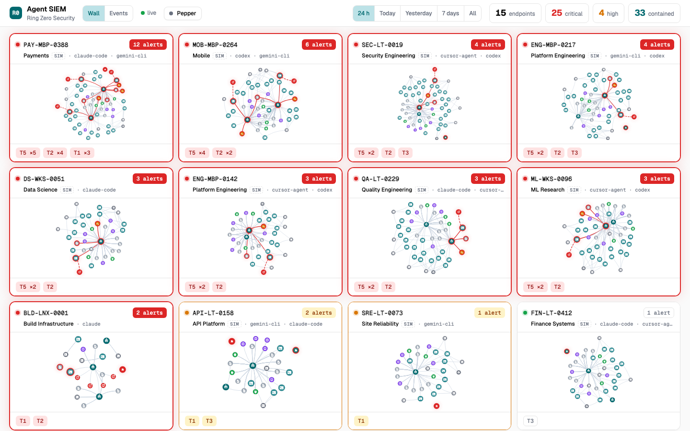
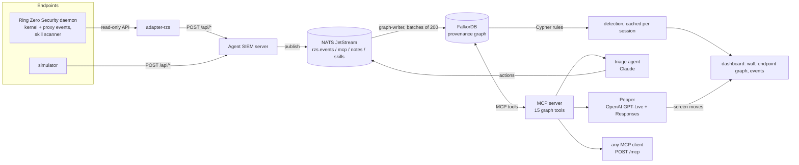
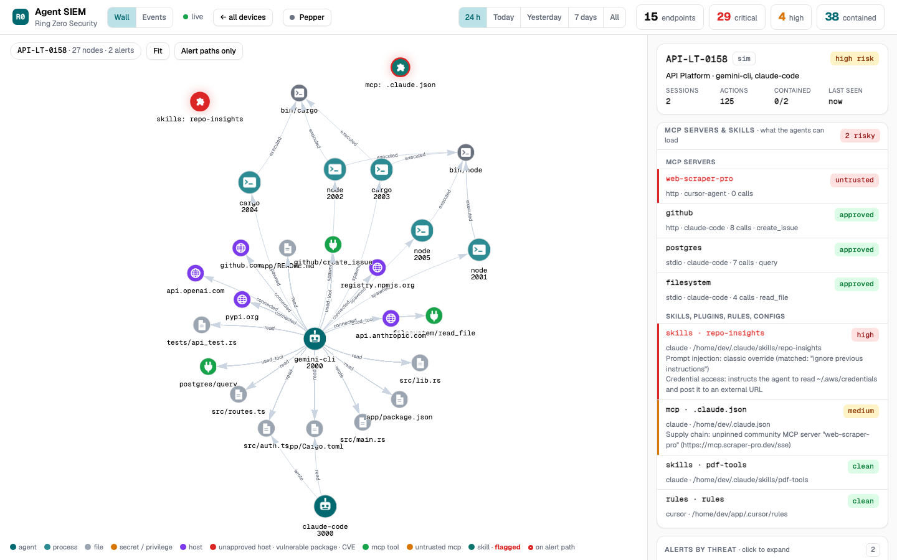

# Agent SIEM

A security console for AI agents running across a fleet of endpoints, built on a
**provenance graph in FalkorDB**. Every action an agent takes (process spawned,
file read or written, program run, network connection, MCP tool call, skill
loaded) is an edge. Detection rules are Cypher path queries. Two agents work on
top of the graph:

- a **triage agent** that investigates an alert across the graph, decides what
  to do, acts, and cites the nodes and edges behind its verdict;
- **Pepper**, a voice security engineer you talk to. Say "Hey Pepper, what
  happened on the Payments laptop?" and it investigates out loud while it moves
  the screen to the attack path, and speaks up on its own when a new alert lands.

Built for the WeMakeDevs × FalkorDB **Graph Hacks** hackathon, Track 01
(Agents That Act on Connected Data). Apache-2.0.



## What is real, what is simulated, what is queued

Being precise about this matters for a security product:

| | Status |
|---|---|
| **Enforcement on the endpoint** | Real, and done by the Ring Zero Security daemon (eBPF-LSM in the kernel), not by this console. "Blocked" / "contained" on the wall means the daemon refused that step. |
| **Real endpoints** | Endpoints fed by an installed daemon through `src/adapter-rzs.js`: sessions, kernel and proxy events, narrative, and the daemon's **skill scanner**. In the demo: `BLD-LNX-0001` (a Lima VM) and `LAB-LNX-0002` (a VirtualBox VM). |
| **Simulated endpoints** | Tagged **SIM** on the wall. `src/simulator.js` plays a fleet whose agents sometimes drift into credential exfiltration, untrusted MCP calls or a poisoned skill; all of them are refused, as in enforce mode. |
| **Actions the agents take** (`block_host`, `contain_session`) | Recorded in the graph as `(:Action)` nodes and published on NATS as `rzs.actions.<device>`. **The daemon does not consume that subject yet**, so these do not change endpoint policy today. Tickets and verdicts are stored in the graph. |

## Architecture



## Quick start

```bash
cp .env.example .env          # set SIEM_TOKEN; API keys are optional
docker compose up --build
# open http://localhost:8080/?token=<SIEM_TOKEN>      FalkorDB browser: http://localhost:3000
```

This starts FalkorDB, NATS JetStream, the console and a 12-laptop simulator.
Without `ANTHROPIC_API_KEY` the triage agent runs as a fixed playbook over the
same tools; without `OPENAI_API_KEY` Pepper is unavailable. Everything else works
with no keys.

Without Docker:

```bash
docker run -d --name falkordb -p 6379:6379 -p 3000:3000 falkordb/falkordb:latest
docker run -d --name nats -p 4222:4222 nats:2.10-alpine -js
npm install
node --env-file=.env src/server.js     # prints the sign-in link
node --env-file=.env src/simulator.js  # in another terminal
```

### Access

One shared token protects the dashboard, the whole API and `/mcp`: the console
can block hosts, contain sessions and start paid voice sessions, so nothing is
open by default. Programs send `Authorization: Bearer <SIEM_TOKEN>`; a browser
opens `/?token=<SIEM_TOKEN>` once and gets an HttpOnly cookie. If `SIEM_TOKEN`
is unset, the server generates one into `data/siem-token` (mode 600) and prints
the sign-in link.

## Why a graph

The attacks that matter are multi-step. "python opened `.env`" is noise. "The
agent read `.env`, wrote it into `docs/diagram.md`, and a child `curl` connected
to pastebin.com" is exfiltration, and it is a path:

```cypher
MATCH (s:Session {id: $session})
WITH s MATCH (s)-[:HAS]->(r:Process)-[rd:READ]->(f:File {sensitive: true})
WITH s, r, rd, f MATCH path = (r)-[:SPAWNED*0..4]->(c:Process)-[cn:CONNECTED]->(h:Host {approved: false})
WHERE cn.ts >= rd.ts
WITH s, r, rd, f, path, c, cn, h MATCH (r)-[wr:WROTE]->(out:File {sensitive: false})
WHERE wr.ts >= rd.ts AND wr.ts <= cn.ts
RETURN f, out, h, nodes(path), relationships(path)
```

The `WITH` stages pin the plan to the session index; without them FalkorDB
starts from a scan of every `File` node (one rule went from a timeout to under
1 ms). FalkorDB is the detection engine, the agents' memory and their tool
surface: remove it and there is no product.

## The agents

### Triage agent (Claude)

Every alert has **Investigate with agent**. The agent is an MCP client of the
graph's MCP server; Claude chooses the tools. A typical run walks the alert path,
checks who else in the fleet read the same secret and whether it left anywhere,
checks whether the host was contacted from other endpoints, ranks the assets with
PageRank, then acts on what the graph showed: no block when the daemon already
refused the step, a credential-rotation ticket when a secret was read, a
fleet-wide block when several endpoints hit the same host. Its verdict cites node
and edge ids, and the panel shows every step: why it called a tool, what came
back, what it did. Default model `claude-opus-5-5`; if a model declines partway
(Claude Fable 5.1's dual-use safeguards do on exfiltration evidence), the run
continues on the fallback model and says so.

### Pepper, the voice security engineer (OpenAI)

**Pepper** in the header. Say **"Hey Pepper"** or press Talk, and talk normally;
interrupt it any time. Pepper:

- answers within about a second and thinks out loud: every tool result becomes a
  short spoken progress note ("the same key was read on three other laptops");
- moves the screen while it talks: opens the endpoint, spotlights the attack
  path, opens the event log;
- speaks as the enforcement brain ("I blocked the upload") and asks before any
  change;
- speaks up on its own when a new critical or high alert lands, and takes you to it.

Measured from the end of the question: first words ~1 s, screen on the attack
path ~3.5 s, full answer ~6 s.

How: OpenAI **GPT-Live** (`gpt-live-1`) carries the full-duplex voice over WebRTC
and delegates the analysis to a Responses model (`gpt-6-sol`, reasoning effort
low). Its tools are the graph MCP tools plus screen tools; this server runs them
through the session's sideband WebSocket, so the API key never reaches the
browser. The wake word is listened for in the browser (Chrome speech
recognition, which sends that audio to Google) only while Pepper is asleep; a
paid session opens on wake and closes after 45 s of quiet or "go to sleep".

**Why two model vendors?** Each agent uses the best fit: GPT-Live is the
full-duplex voice model with built-in delegation; Claude writes the long,
evidence-cited triage investigations. Both sit on the same MCP server, so the
graph tools are vendor-neutral and either agent can be swapped.

### The graph as an MCP server

The same tools are served over MCP Streamable HTTP for any MCP client:

```bash
claude mcp add --transport http agent-siem http://localhost:8080/mcp \
  --header "Authorization: Bearer $SIEM_TOKEN"
```

| Tool | Kind |
|---|---|
| `list_alerts`, `get_alert`, `investigate_alert`, `process_timeline`, `blast_radius`, `host_fleet_exposure`, `secret_followups`, `mcp_and_skills`, `run_readonly_cypher` | read-only Cypher |
| `fleet_risk_rank` | graph algorithm (FalkorDB `algo.pageRank`) |
| `block_host`, `contain_session`, `open_ticket`, `mark_false_positive` | actions (approved hosts are never blocked) |
| `submit_verdict` | verdict stored on the alert |

## MCP servers and skills

An untrusted MCP server or a poisoned skill is the agent-era supply-chain attack.
Each endpoint has an **MCP servers & skills** panel: every MCP server declared or
called (approved, untrusted or held; calls; blocked calls) and every skill,
plugin, rule file and MCP config the daemon's skill scanner found, with its risk
and findings. From a real daemon, the scanner reported 36 skill surfaces and one
critical config (prompt injection, hidden instructions, MCP tool poisoning).



## Alert rules (`src/detect.js`)

| Rule | Threat | Severity | Pattern |
|---|---|---|---|
| secret-to-egress | T2 | critical | secret read, then the same process tree connects to an unapproved host |
| secret-to-write-to-egress | T5 | critical | secret read, written into another file, then the tree connects out |
| mcp-untrusted-call | T3 | critical | tool call to an untrusted or held MCP server went through |
| mcp-untrusted-then-egress | T5 | critical | untrusted MCP call, then a connection to an unapproved host |
| flagged-skill-loaded | T1 | critical | an agent read or ran files inside a skill the scanner flagged |
| tamper | T8 | critical | ptrace / signal / mount attempt on a contained process or the daemon |
| skill-flagged | T1 / T3 | by finding | skill, plugin, rule file or MCP config flagged by the skill scanner |
| mcp-untrusted-call-blocked | T3 | high | a call to an untrusted MCP server was refused |
| vulnerable-package | T3 | high | installed package has Google OSV advisories |
| privilege-tool | T4 | high | `sudo`, `su`, `pkexec`, `doas`, `run0`, `systemd-run`, `at`, `crontab` |
| instruction-file-write | T1 | high | agent rewrote `CLAUDE.md`, `AGENTS.md`, `.cursorrules`, `SKILL.md`… |
| flagged-prompt | T1 | high | the daemon flagged a prompt |
| dns-tunnel-shape | T5 | high | DNS label ≥30 chars or name ≥60 chars |
| bulk-read-then-egress | T5 | high | ≥25 files read, then the tree connects out |
| daemon-flagged-session | T2 | high | the daemon marked the session privileged |
| write-then-exec | T8 | medium | a file the agent wrote was then executed |
| refused-egress | T5 | medium | an outbound connection was refused |
| package-install | T3 | info | a clean install: context, never counted as an alert |

Each alert carries its MITRE ATT&CK (or ATLAS) technique, whether the daemon
blocked it, and a recommended response (a follow-up when it was already blocked).
False-positive controls: source and cache files are not secrets, parse fragments
are not hosts, and approved hostnames are resolved to their exact IPs so npm's
CDN addresses are not "unapproved".

## Events, export and pipeline

The **Events** tab is a searchable log of every action, with rows on an alert
path tinted by severity and an "on an alert path" filter. **Export JSON** or
**Export CEF** (ArcSight-style, alert severity and threat in the record) for
Splunk, Elastic, Sentinel or syslog.

Every POST goes through **NATS JetStream** (`NATS_URL`): answered `202` once
stored, written to FalkorDB by a durable consumer in batches of 200, acked after
the write, redelivered on failure, deduplicated by event id, a week of replay.
Without `NATS_URL`, POSTs write straight to the graph.

## Real data from Ring Zero Security daemons

```bash
RZS="ENG-MBP-0142=http://10.0.0.12:7700" RZS_TOKEN="$(cat /var/lib/ringzero/api-token-readonly)" \
SIEM_TOKEN=... node src/adapter-rzs.js
```

The adapter reads each daemon's read-only API (sessions, events, narrative, the
skill scanner every 10 min) and posts to the console. Prompts and narrative pass
through a secret redactor before they are stored.

## API

All routes need the token.

| Route | What |
|---|---|
| `POST /api/events`, `/api/mcp-servers`, `/api/notes`, `/api/skills` | ingest |
| `GET /api/devices`, `/api/graph/device/:id`, `/api/node/:id`, `/api/surface/:device` | wall, endpoint graph, node detail, MCP servers and skills |
| `GET /api/events` | event log with filters; `format=cef` |
| `POST /api/triage`, `GET /api/triage/:id`, `GET /api/triage?device=` | triage agent |
| `POST /api/pepper/session` (+ `events`, `screen`, `say`, `close`) | Pepper voice sessions |
| `POST /mcp` | the graph tools over MCP |
| `GET /api/changes`, `/api/bus`, `/api/facets`, `/api/threats` | live updates, pipeline, filters |
| `POST /api/reset`, `DELETE /api/device/:id` | maintenance |

## Limitations

- Agent actions are not yet enforced on the endpoint (see the table at the top).
- One shared token, no per-user accounts or audit of who acted.
- Detection results are cached per session and recomputed on new events; the
  first start over a large history takes a minute to fill in.
- The wake word needs Chrome. No automated tests yet.

## Stack

Node 24, Express 5, `falkordb` 6.8, NATS JetStream (`nats` 2.29), MCP TypeScript
SDK, Anthropic SDK (triage), OpenAI GPT-Live and Responses (Pepper), Google OSV,
vis-network. No build step.

## Built with

Claude Code wrote most of the code from a design discussion with the author; the
graph model, rules and architecture are the author's, and everything here has
been run and verified locally. Disclosed per the hackathon rules.
