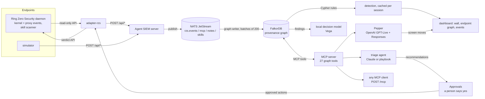
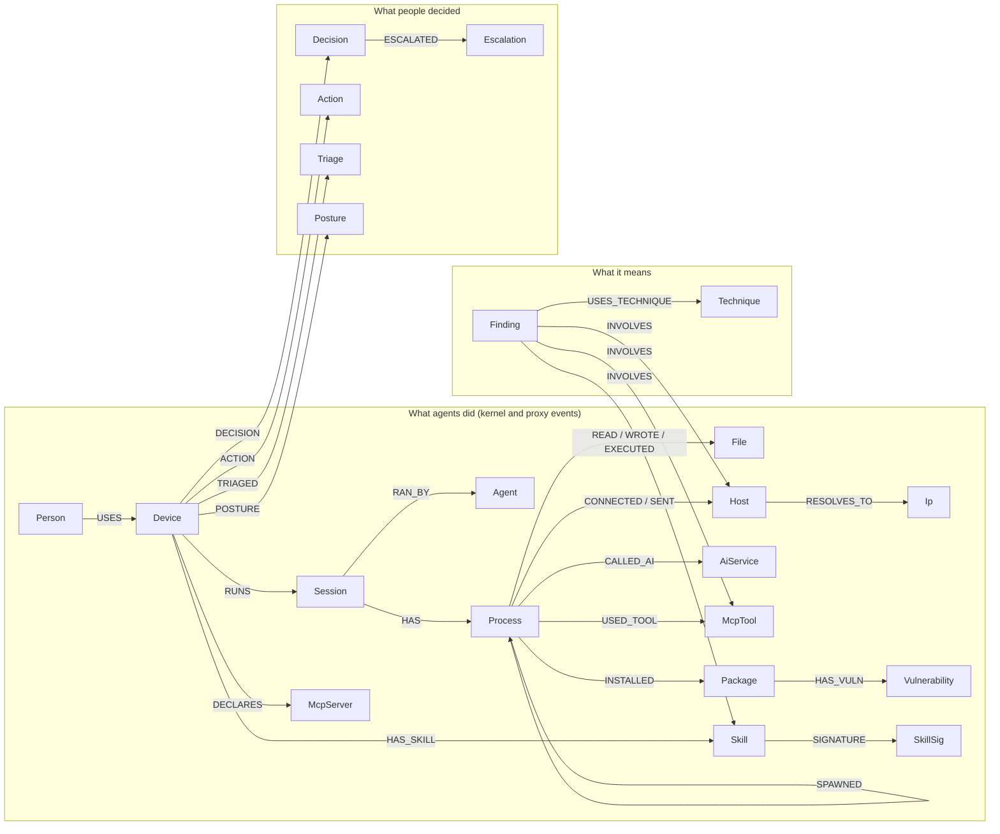
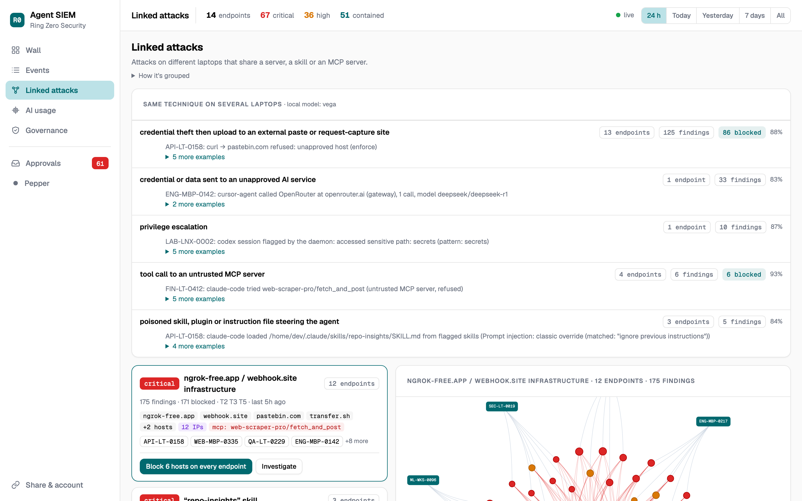
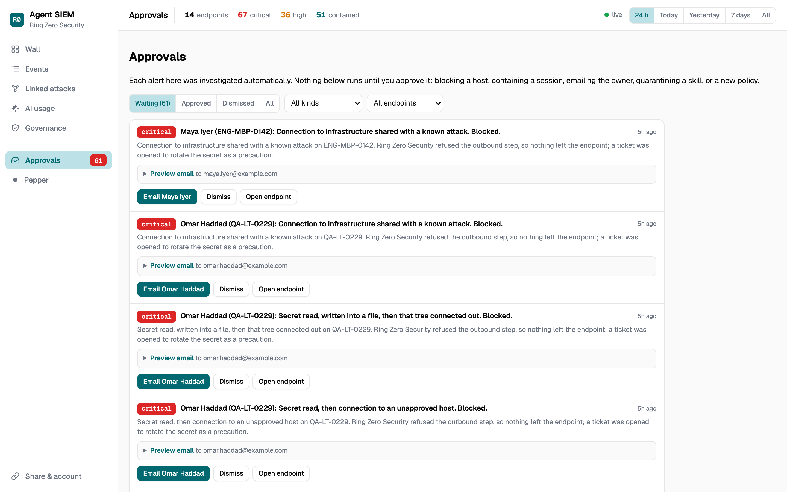

# Agent SIEM

A security console for AI agents running across a fleet of endpoints, built on a
**provenance graph in FalkorDB**. Every action an agent takes (process spawned,
file read or written, program run, network connection, MCP tool call, skill
loaded) is an edge. Detection rules are Cypher path queries. Two agents work on
top of the graph:

- a **triage agent** that investigates an alert across the graph, recommends
  what to do, and cites the nodes and edges behind its verdict;
- **Pepper**, a voice security engineer you talk to. Say "Hey Pepper, what
  happened on the Payments laptop?" and it investigates out loud while it moves
  the screen to the attack path, and speaks up on its own when a new alert lands.

Built for the WeMakeDevs × FalkorDB **Graph Hacks** hackathon, Track 01
(Agents That Act on Connected Data). Apache-2.0.


## What is real and what is simulated

Being precise about this matters for a security product:

| | Status |
|---|---|
| **The data in the demo** | A **simulated fleet** of 12 laptops (each tagged **SIM**): `src/simulator.js` plays AI agents doing normal work that sometimes drift into credential exfiltration, untrusted MCP calls, shadow AI or a poisoned skill. No real company data. |
| **Real endpoints** | Endpoints with the Ring Zero Security daemon installed feed the same pipeline through `src/adapter-rzs.js`: sessions, kernel and proxy events, narrative, and the daemon's skill scanner. |
| **Enforcement** | Real, done by the Ring Zero Security daemon (eBPF LSM in the kernel), not by this console. Approved actions (block a host, contain a session, quarantine a skill) are sent to the daemon's verdict API and installed as kernel rules; verified on a Linux machine. On simulated endpoints they are recorded as *simulated*. |
| **Who decides** | Investigations (the triage agent, the playbook, Pepper) only **recommend**. Nothing that changes an endpoint runs until a person approves it in **Approvals**. |

## Architecture



## Quick start

```bash
cp .env.example .env          # set SIEM_TOKEN and SIEM_PASSWORD; API keys are optional
docker compose up --build
# open http://localhost:8080 and sign in with SIEM_PASSWORD   FalkorDB browser: http://localhost:3000
```

This starts FalkorDB, NATS JetStream, the console and a 12-laptop simulator.
Without `ANTHROPIC_API_KEY` the triage agent runs as a fixed playbook over the
same tools; without `OPENAI_API_KEY` Pepper is unavailable. Everything else works
with no keys.

Without Docker:

```bash
docker run -d --name falkordb -p 6379:6379 -p 3000:3000 falkordb/falkordb:latest
docker run -d --name nats -p 4222:4222 nats:2.10-alpine -js
npm install
node --env-file=.env src/server.js
node --env-file=.env src/simulator.js  # in another terminal
```

### Access

Nothing is open by default: the console can block hosts, contain sessions and
start paid voice sessions.

- **People** sign in with the master password (`SIEM_PASSWORD`) and get a signed
  session cookie (never the password). Five wrong tries lock that client out for
  15 minutes.
- **Read-only links** (Share & account → Create link) let someone explore every
  screen, investigate and talk to Pepper; anything that changes state is refused
  by the server. Links expire and can be revoked.
- **Programs** (simulator, adapter, MCP clients) send
  `Authorization: Bearer <SIEM_TOKEN>`.

## The graph

Everything is one FalkorDB graph in three layers: what agents did, what it means,
and what people decided.



Every alert, verdict and action points back at the nodes and edges it came from,
so any decision can be explained by walking the graph.



### Where the decisions come from

| Question | How the graph answers it |
|---|---|
| Is this exfiltration? | A multi-hop Cypher path: secret **READ** → **WROTE** → any descendant (**SPAWNED*0..4**) **CONNECTED** to an unapproved host (below). 21 rules in `src/detect.js` are graph queries like it. |
| Is this one attack across many laptops? | `algo.WCC` over findings and the infrastructure they **INVOLVE**: hosts, the IPs they **RESOLVE_TO**, skill signatures, MCP tools. Two laptops sending secrets to the same server, or loading the same poisoned skill, land in one **linked attack**; a new domain on a known attack server is flagged on first contact. Well-known services (AI providers, big clouds) link through `USES_SERVICE`, which the algorithm does not follow, so they never glue attacks together. |
| How important is this host or secret? | `algo.pageRank` over the whole graph ranks sensitive files and routable hosts (the `fleet_risk_rank` tool). |
| Did the secret go anywhere else? | `secret_followups` and `host_fleet_exposure`: every reader of the same file across the fleet and what each connected to afterwards. |
| Which processes are the same thing? | The endpoint view groups processes by program and parent program (`python3 ×47`) and merges a host with its AI service, straight from the **SPAWNED** and **CALLED_AI** edges. |
| What did a person approve, and when? | `Decision`, `Action` and `Escalation` nodes: the audit trail behind Approvals and the ISO/IEC 42001 evidence. |

```cypher
// Linked attacks
CALL algo.WCC({nodeLabels: ['Finding', 'Host', 'McpTool', 'Skill', 'SkillSig', 'Ip'],
               relationshipTypes: ['INVOLVES', 'RESOLVES_TO', 'SIGNATURE']})
YIELD node, componentId
WITH node, componentId WHERE node:Finding
RETURN componentId, collect(node) AS findings

// Risk rank
CALL algo.pageRank(NULL, NULL) YIELD node, score
WITH node, score WHERE (node:File AND node.sensitive = true) OR node:Host
RETURN node, score ORDER BY score DESC LIMIT 10
```

## Why a graph

The attacks that matter are multi-step. "python opened `.env`" is noise. "The
agent read `.env`, wrote it into `docs/diagram.md`, and a child `curl` connected
to pastebin.com" is exfiltration, and it is a path:

```cypher
MATCH (s:Session {id: $session})
WITH s MATCH (s)-[:HAS]->(r:Process)-[rd:READ]->(f:File {sensitive: true})
WITH s, r, rd, f MATCH path = (r)-[:SPAWNED*0..4]->(c:Process)-[cn:CONNECTED]->(h:Host {approved: false})
WHERE cn.ts >= rd.ts
WITH s, r, rd, f, path, c, cn, h MATCH (r)-[wr:WROTE]->(out:File {sensitive: false})
WHERE wr.ts >= rd.ts AND wr.ts <= cn.ts
RETURN f, out, h, nodes(path), relationships(path)
```

The `WITH` stages pin the plan to the session index; without them FalkorDB
starts from a scan of every `File` node (one rule went from a timeout to under
1 ms). FalkorDB is the detection engine, the agents' memory and their tool
surface: remove it and there is no product.

## The agents

### Triage agent (Claude)

Every alert has **Investigate with agent**. The agent is an MCP client of the
graph's MCP server; Claude chooses the tools. A typical run walks the alert path,
checks who else in the fleet read the same secret and whether it left anywhere,
checks whether the host was contacted from other endpoints, ranks the assets with
PageRank, then recommends what the graph showed: no block when the daemon
already refused the step, a credential-rotation ticket when a secret was read,
blocking the host (fleet-wide when several endpoints hit it) and containing the
session when it got through. Blocks and containment are **recommendations** that
land in Approvals; it never blocks `localhost` or private addresses. Its verdict
cites node and edge ids, and the panel shows every step: why it called a tool,
what came back, what it recommended. With `ANTHROPIC_API_KEY` it runs on Claude
(default `claude-opus-5-5`; if a model declines partway, the run continues on a
fallback and says so); without it, a fixed playbook runs over the same tools and
its verdict says it is rule-based.

### Pepper, the voice security engineer (OpenAI)

**Pepper** in the sidebar. Say **"Hey Pepper"** or press Talk, and talk normally;
interrupt it any time. Pepper:

- answers within about a second and thinks out loud: every tool result becomes a
  short spoken progress note ("the same key was read on three other laptops");
- moves the screen while it talks: opens the endpoint, spotlights the attack
  path, opens the event log;
- speaks as the enforcement brain ("I blocked the upload") and asks before any
  change;
- speaks up on its own when a new critical or high alert lands, and takes you to it.

Measured from the end of the question: first words ~1 s, screen on the attack
path ~3.5 s, full answer ~6 s.

How: OpenAI **GPT-Live** (`gpt-live-1`) carries the full-duplex voice over WebRTC
and delegates the analysis to a Responses model (`gpt-6-sol`, reasoning effort
low). Its tools are the graph MCP tools plus screen tools; this server runs them
through the session's sideband WebSocket, so the API key never reaches the
browser. The wake word is listened for in the browser (Chrome speech
recognition, which sends that audio to Google) only while Pepper is asleep; a
paid session opens on wake and closes after 45 s of quiet or "go to sleep".

**Why two model vendors?** Each agent uses the best fit: GPT-Live is the
full-duplex voice model with built-in delegation; Claude writes the long,
evidence-cited triage investigations. Both sit on the same MCP server, so the
graph tools are vendor-neutral and either agent can be swapped.

### The graph as an MCP server

The same tools are served over MCP Streamable HTTP for any MCP client:

```bash
claude mcp add --transport http agent-siem http://localhost:8080/mcp \
  --header "Authorization: Bearer $SIEM_TOKEN"
```

| Tool | Kind |
|---|---|
| `fleet_summary`, `list_alerts`, `get_alert`, `investigate_alert`, `process_timeline`, `blast_radius`, `host_fleet_exposure`, `secret_followups`, `mcp_and_skills`, `ai_usage`, `indicator_intel`, `fleet_inventory`, `iso42001_readiness`, `list_decisions`, `scan_status`, `run_readonly_cypher` | read-only Cypher |
| `list_campaigns` (linked attacks) | graph algorithm (FalkorDB `algo.WCC`) |
| `list_playbooks` | local decision model (Vega) |
| `run_deep_scan`, `propose_policies`, `approve_decision`, `dismiss_decision` | fleet actions (proposals need a yes) |
| `fleet_risk_rank` | graph algorithm (FalkorDB `algo.pageRank`) |
| `block_host`, `contain_session`, `quarantine_skill`, `open_ticket`, `mark_false_positive` | actions: recommendations inside an investigation; approved, local and private hosts are never blocked |
| `submit_verdict` | verdict stored on the alert |

## Shadow AI discovery

The **AI usage** view lists every AI service the fleet talks to, recognized by
**what the traffic says**, not by a hostname list: OpenAI-, Anthropic-, Gemini-,
Bedrock- and Ollama-style request and response shapes (paths such as
`/v1/chat/completions`, `/v1/messages`, `:generateContent`; body keys such as
`model` + `messages`, `max_tokens`, `generationConfig`; headers such as
`anthropic-version`; streamed `choices`/`delta` responses). That finds OpenRouter,
LiteLLM and corporate gateways, Groq, DeepSeek, self-hosted models, and scripts
or notebooks calling AI APIs that nobody registered as an agent
(`src/shadowai.js`). Requests just below the rule threshold get a second opinion
from the local decision model. Alerts: data to an unapproved AI service, a
secret sent to one, and unregistered agents. The daemon change that feeds this
from real endpoints is specified in `docs/shadow-ai-daemon-spec.md`.

## Approvals

Every alert that needs a person ends up here, with the investigation's summary and
the proposed next steps: block a host, contain a session, quarantine a skill,
email the owner, or a policy. Waiting / Approved / Dismissed tabs, filters by kind
and endpoint, and for each decided item who decided, when, and what ran.
**Linked attacks** adds "Block on every endpoint" and "Quarantine skill on every
endpoint"; skill alerts have "Quarantine skill" (it blocks exactly the files the
scanner flagged). All of them ask for a second click to confirm.



## Autopilot: the proactive loop

A new critical or high finding is investigated on its own (the triage
playbook, or Claude with `AUTOPILOT_AGENT=claude`; one at a time, capped per
hour). The result lands in **Approvals** as a decision with the endpoint's
owner and the proposed next step, typically an escalation email to the
employee with their manager in cc. Pepper raises it out loud ("An agent on
Elena's laptop sent data to DeepSeek. Should I email her?"). Nothing with
consequences runs without a yes; emails go out through `SMTP_URL` when set and
are saved as drafts otherwise.

## Governance: deep scan, policies, ISO/IEC 42001

The **Governance** view (or "Pepper, deep scan the fleet") queues a scan on
every endpoint; the adapter runs the daemon's read-only scanners (skills,
non-human identities, health, posture, supply chain, its compliance
self-assessment) and reports back. The fleet inventory shows per endpoint the
owner, agents, AI services, unregistered agents, MCP servers, skills and
posture. **Propose policies** turns what was found into decisions in Approvals
(block unapproved AI services, remove untrusted MCP servers, quarantine flagged
skills, register unregistered agents). **ISO/IEC 42001 readiness** maps the
graph's evidence to Annex A areas A.2 to A.10 with the gaps to close. It is
evidence for an audit, not a certification.

## The local decision model

`brain/` runs a calibrated decision model on this machine (Vega 0.8B by
default, Laya as a fallback); nothing is sent to an outside AI provider. It
labels each finding with an attack technique and a priority (stored only when
it does not abstain), groups findings into **playbooks** (the same technique
across endpoints, even with different infrastructure), and gives a second
opinion on borderline AI traffic. Measured on an Apple M5 CPU: about 130 ms
per decision once warm. It runs alongside the stream, so nothing waits on it.
Zero-shot pairwise "same actor" linking was not reliable enough, so it does not
create linked-attack groups; fine-tuning on our own labelled findings is the next
step.

```bash
brain/run.sh        # 127.0.0.1:7811; the console uses it when it is running
```

## MCP servers and skills

An untrusted MCP server or a poisoned skill is the agent-era supply-chain attack.
Each endpoint has an **MCP servers & skills** panel: every MCP server declared or
called (approved, untrusted or held; calls; blocked calls) and every skill,
plugin, rule file and MCP config the daemon's skill scanner found, with its risk
and findings. From a real daemon, the scanner reported 36 skill surfaces and one
critical config (prompt injection, hidden instructions, MCP tool poisoning).


## Alert rules (`src/detect.js`)

| Rule | Threat | Severity | Pattern |
|---|---|---|---|
| secret-to-egress | T2 | critical | secret read, then the same process tree connects to an unapproved host |
| secret-to-write-to-egress | T5 | critical | secret read, written into another file, then the tree connects out |
| mcp-untrusted-call | T3 | critical | tool call to an untrusted or held MCP server went through |
| mcp-untrusted-then-egress | T5 | critical | untrusted MCP call, then a connection to an unapproved host |
| secret-to-shadow-ai | T2 | critical | secret read, then the tree sent data to an unapproved AI service |
| linked-to-campaign-infra | T5 | critical | connection to a host on the same server (IP) as a host used in an attack on another endpoint |
| flagged-skill-loaded | T1 | critical | an agent read or ran files inside a skill the scanner flagged |
| tamper | T8 | critical | ptrace / signal / mount attempt on a contained process or the daemon |
| skill-flagged | T1 / T3 | by finding | skill, plugin, rule file or MCP config flagged by the skill scanner |
| mcp-untrusted-call-blocked | T3 | high | a call to an untrusted MCP server was refused |
| shadow-ai | T5 | high | data sent to an AI service that is not approved (recognized by protocol, not hostname) |
| unregistered-ai-agent | T7 | high | a process that is not a known agent is calling an AI API |
| vulnerable-package | T3 | high | installed package has Google OSV advisories |
| privilege-tool | T4 | high | `sudo`, `su`, `pkexec`, `doas`, `run0`, `systemd-run`, `at`, `crontab` |
| instruction-file-write | T1 | high | agent rewrote `CLAUDE.md`, `AGENTS.md`, `.cursorrules`, `SKILL.md`… |
| flagged-prompt | T1 | high | the daemon flagged a prompt |
| dns-tunnel-shape | T5 | high | DNS label ≥30 chars or name ≥60 chars |
| bulk-read-then-egress | T5 | high | ≥25 files read, then the tree connects out |
| daemon-flagged-session | T2 | high | the daemon marked the session privileged |
| write-then-exec | T8 | medium | a file the agent wrote was then executed |
| refused-egress | T5 | medium | an outbound connection was refused |
| package-install | T3 | info | a clean install: context, never counted as an alert |

Each alert carries its MITRE ATT&CK (or ATLAS) technique, whether the daemon
blocked it, and a recommended response (a follow-up when it was already blocked).
False-positive controls: source and cache files are not secrets, parse fragments
are not hosts, and approved hostnames are resolved to their exact IPs so npm's
CDN addresses are not "unapproved".

## Events, export and pipeline

The **Events** tab is a searchable log of every action, with rows on an alert
path tinted by severity and an "on an alert path" filter. **Export JSON** or
**Export CEF** (ArcSight-style, alert severity and threat in the record) for
Splunk, Elastic, Sentinel or syslog.

Every POST goes through **NATS JetStream** (`NATS_URL`): answered `202` once
stored, written to FalkorDB by a durable consumer in batches of 200, acked after
the write, redelivered on failure, deduplicated by event id, a week of replay.
Without `NATS_URL`, POSTs write straight to the graph.

## Real data from Ring Zero Security daemons

```bash
RZS="ENG-MBP-0142=http://10.0.0.12:7700" RZS_TOKEN="$(cat /var/lib/ringzero/api-token-readonly)" \
SIEM_TOKEN=... node src/adapter-rzs.js
```

The adapter reads each daemon's read-only API (sessions, events, narrative, the
skill scanner every 10 min) and posts to the console. Prompts and narrative pass
through a secret redactor before they are stored.

## API

All routes need the token.

| Route | What |
|---|---|
| `POST /api/events`, `/api/mcp-servers`, `/api/notes`, `/api/skills` | ingest |
| `GET /api/devices`, `/api/graph/device/:id`, `/api/node/:id`, `/api/surface/:device` | wall, endpoint graph, node detail, MCP servers and skills |
| `GET /api/events` | event log with filters; `format=cef` |
| `POST /api/triage`, `GET /api/triage/:id`, `GET /api/triage?device=` | triage agent |
| `POST /api/pepper/session` (+ `events`, `screen`, `say`, `close`) | Pepper voice sessions |
| `POST /mcp` | the graph tools over MCP |
| `GET /api/changes`, `/api/bus`, `/api/facets`, `/api/threats` | live updates, pipeline, filters |
| `POST /api/reset`, `DELETE /api/device/:id` | maintenance |

## Limitations

- The demo fleet is simulated (see the table at the top); kernel enforcement was
  verified on a real Linux endpoint, not on the simulated laptops.
- One master password plus read-only links; no per-user accounts yet.
- Detection results are cached per session and recomputed on new events; the
  first start over a large history takes a minute to fill in.
- The wake word needs Chrome. No automated tests yet.

## Stack

Node 24, Express 5, `falkordb` 6.8, NATS JetStream (`nats` 2.29), MCP TypeScript
SDK, Anthropic SDK (triage), OpenAI GPT-Live and Responses (Pepper), Google OSV,
vis-network. No build step.

## Built with

Claude Code wrote most of the code from a design discussion with the author; the
graph model, rules and architecture are the author's, and everything here has
been run and verified locally. Disclosed per the hackathon rules.
